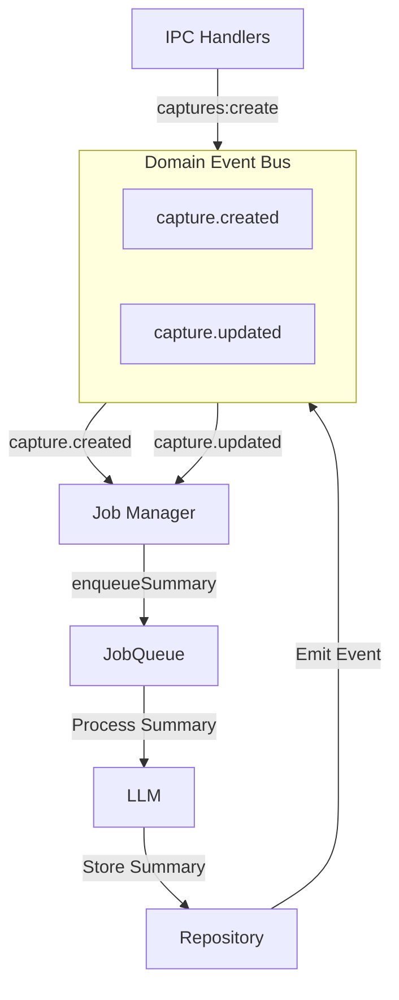

# Automatic Project Summary Update Specification

| Document Metadata      | Details                                                                        |
| --------------------- | -------------------------------------------------------------------------- |
| Author(s)              | Nick Pape                                                                |
| Status                 | Draft (WIP)                                                              |
| Team / Owner           | Open Loops Development Team                                             |
| Created / Last Updated | 2026-02-07                                                             |

## 1. Executive Summary

This specification proposes implementing automatic updates of AI-generated project descriptions (summaries) whenever new captures are added to a project. Currently, project summaries must be generated manually, creating a gap where project summaries become outdated as new information is captured. The proposed solution leverages the existing event-driven architecture and job queue system to automatically trigger summary regeneration when captures are added or updated.

**Context:** Projects are collections of captures with AI-generated summaries. New captures are added via upload, paste, recording, or manual entry.

**Problem:** Project summaries become stale as new captures are added, requiring manual regeneration to reflect the complete project scope.

**Solution:** Implement event listeners that automatically trigger summary regeneration when captures are added to projects.

**Impact:** Improves data consistency, reduces manual overhead, and ensures project summaries always reflect current content.

## 2. Context and Motivation

### 2.1 Current State

The system currently has:
- Projects that contain collections of captures
- AI-generated summaries for projects stored in the `project_summaries` table
- Event-driven architecture with domain events for all data mutations
- Background job queue system for AI operations (transcription, summary, tag generation)
- Pattern of automatic tag generation when captures are added

**Architecture:** The codebase uses a CQRS pattern with domain events and a job queue system. Domain events are emitted after data mutations and can be listened to by any service component.

**Limitations:**
- Project summaries are only updated manually via UI buttons
- No automatic trigger to regenerate summaries when project content changes
- This creates a gap where project summaries may not reflect current captures

### 2.2 The Problem

**User Impact:**
- Users must manually regenerate project summaries after adding new captures
- Project summaries may be outdated and not reflect the current state of the project
- Redundant work required to keep summaries current

**Business Impact:**
- Reduced efficiency in project management workflow
- Inconsistent project documentation state

**Technical Debt:**
- Inconsistent with existing pattern of automatic tag generation
- Incomplete automation of project summarization

## 3. Goals and Non-Goals

### 3.1 Functional Goals

- [ ] Automatically regenerate project summary when new captures are added to a project
- [ ] Automatically regenerate project summary when captures in a project are updated
- [ ] Preserve existing manual summary generation functionality
- [ ] Integrate with existing job queue system for background processing
- [ ] Emit correct domain events for UI updates and audit trail

### 3.2 Non-Goals (Out of Scope)

- [ ] Changes to summary generation algorithm or prompting
- [ ] Changes to job queue scheduling or prioritization
- [ ] Manual triggers for summary regeneration (already implemented)
- [ ] Real-time updates to UI (existing event system handles this)

## 4. Proposed Solution (High-Level Design)

### 4.1 System Architecture Diagram



### 4.2 Architectural Pattern

**Event-Driven CQRS Pattern**
- Domain events drive all automation
- Job queue handles background AI processing
- Event emitters provide consistency across the UI

### 4.3 Key Components

| Component         | Responsibility                              | Technology Stack          | Justification                                      |
| ----------------- |----------------------------------------------|----------------------------|----------------------------------------------------|
| Domain Events     | Event bus for domain mutations              | Custom domain events      | Consistent with existing event system               |
| Event Listener    | Listens for capture events                   | TypeScript                 | Central location for event handling                 |
| Job Manager       | Queues and manages summary jobs              | Existing job manager       | Already handles AI operations                       |
| Job Worker        | Executes summary generation                   | Existing job worker        | Already processes summary jobs                       |
| Repository        | Stores generated summaries                    | Drizzle ORM               | Existing database abstraction                       |
| LLM Provider      | Runs LLMs to generate summaries               | Ollama/OpenAI             | Existing AI integration                            |

## 5. Detailed Design

### 5.1 Integration Points

**Primary Integration Point:** `src/main/main.ts` - Domain event listener

```typescript
// Current code (lines 169-183)
const setupEventListeners = () => {
  // Tag generation on capture create
  domainEvents.on('capture.created', async (event) => {
    if (event.type === 'text' || event.type === 'decision') {
      await jobManager.enqueueTagGeneration(event.id);
    }
  });
  
  // Tag generation on capture update
  domainEvents.on('capture.updated', async (event) => {
    if (event.type === 'text' || event.type === 'decision') {
      await jobManager.enqueueTagGeneration(event.id);
    }
  });
};
```

**Proposed Addition:** Add summary regeneration logic to the same event listener.

### 5.2 Data Flow

**Capture Created Flow:**
1. User adds capture via IPC (`captures:create`)
2. `CaptureCommands.createCapture()` creates record in database
3. `capture.created` event emitted with `projectId` or `linkedTaskId`
4. Event listener in `main.ts` receives event
5. For project-level captures:
   - Determine `projectId` (directly from `event.projectId` or via `event.linkedTaskId`)
   - Call `jobManager.enqueueSummary(projectId)` to queue summary job
6. Job worker processes summary generation
7. Summary stored in `project_summaries` table
8. `summary.generated` event emitted for UI updates

**Capture Updated Flow:**
1. User updates capture via IPC (`captures:update`)
2. `CaptureCommands.updateCapture()` updates record in database
3. `capture.updated` event emitted with `id`
4. Event listener in `main.ts` receives event
5. Fetch capture to determine `projectId`
6. For project-level captures:
   - Call `jobManager.enqueueSummary(projectId)` to queue summary job
7. Job worker processes summary generation
8. Summary stored in `project_summaries` table
9. `summary.generated` event emitted for UI updates

### 5.3 Captures and Projects

Captures can be linked to projects in two ways:
1. **Direct link**: `capture.projectId` points directly to a project
2. **Task link**: `capture.linkedTaskId` points to a task, which has `task.projectId`

**Resolution Logic:**
```typescript
const getProjectIdForCapture = async (captureId: string): Promise<string | null> => {
  const capture = await repository.getCapture(captureId);
  
  // Check direct project link
  if (capture.projectId) {
    return capture.projectId;
  }
  
  // Check task link
  if (capture.linkedTaskId) {
    const task = await repository.getTask(capture.linkedTaskId);
    return task?.projectId || null;
  }
  
  return null;
};
```

### 5.4 Debouncing and Rate Limiting

**Debouncing Strategy:**
- Track pending summary jobs by project ID
- Debounce summary regeneration if a job is already pending for the project
- Wait for completion of current job before queueing new one

**Implementation:**
```typescript
// In job-manager.ts
const pendingSummaries = new Map<string, Promise<void>>(); // projectId -> Promise

async function enqueueSummary(projectId: string) {
  // Check if already pending
  if (pendingSummaries.has(projectId)) {
    return;
  }
  
  const promise = (async () => {
    try {
      await generateSummary(projectId);
    } finally {
      pendingSummaries.delete(projectId);
    }
  })();
  
  pendingSummaries.set(projectId, promise);
  await promise;
}
```

### 5.5 Event Emission

**Events to Emit:**
- `summary.generated` after successful summary generation (already implemented)
- Event data should include `projectId` for UI updates

## 6. Alternatives Considered

| Option                            | Pros                                  | Cons                                  | Reason for Rejection                           |
| --------------------------------- | ------------------------------------- | ---------------------------------------- | ---------------------------------------------- |
| **Immediate synchronous generation** | Simple implementation                   | Blocks UI, poor user experience          | User experience and system responsiveness     |
| **Polling-based detection**         | Simple to implement                     | Inefficient, race conditions possible    | Already have event system, no need for polling   |
| **Database triggers**               | Always in sync                          | Tight coupling, hard to test/debug      | Prefer application-level event handling       |
| **Event-driven (Selected)**         | Consistent with architecture           | Slightly more complex                    | **Selected:** Best fits existing patterns     |

## 7. Cross-Cutting Concerns

### 7.1 Security and Privacy

- **Authentication:** No changes needed; existing IPC security model applies
- **Authorization:** No changes needed; project ownership already checked in repository
- **Data Protection:** Summaries contain derived data only; no additional PII concerns

### 7.2 Observability Strategy

- **Metrics:** Enhance existing job metrics to track automatic vs manual summary jobs
- **Tracing:** Extend existing trace context through event chain
- **Alerting:** Existing job failure alerts apply; no new alerts needed
- **Logging:** Ensure capture events log `projectId` for debugging

### 7.3 Scalability and Capacity Planning

- **Throughput:** Summary generation already tested at scale; no impact from automation
- **Storage:** Additional summaries stored, but within existing growth patterns
- **Job Queue:** Already handles concurrent AI operations; summary jobs are lightweight

## 8. Migration, Rollout, and Testing

### 8.1 Deployment Strategy

- **Phase 1:** Add event listeners in development mode with feature flag
- **Phase 2:** Internal testing with feature flag enabled
- **Phase 3:** Release in production (feature flag removed)

**Feature Flag:**
```typescript
// In main.ts
const AUTO_UPDATE_SUMMARIES = process.env.ENABLE_AUTO_SUMMARIES === 'true';

if (AUTO_UPDATE_SUMMARIES) {
  domainEvents.on('capture.created', handleCaptureEvent);
  domainEvents.on('capture.updated', handleCaptureEvent);
}
```

### 8.2 Data Migration Plan

- **No data migration required**
- Existing summaries remain in place
- New summaries will be generated automatically as captures are added

### 8.3 Test Plan

**Unit Tests:**
- Test `getProjectIdForCapture()` with direct project link
- Test `getProjectIdForCapture()` with task link
- Test `getProjectIdForCapture()` with no project/task link

**Integration Tests:**
- Test event listener receives capture.created event
- Test summary job enqueued after capture.created event
- Test summary job enqueued after capture.updated event
- Test debouncing of summary jobs for same project

**End-to-End Tests:**
- Test capture creation triggers summary regeneration
- Test capture update triggers summary regeneration
- Test UI receives summary.generated event after capture added
- Test multiple captures from different projects each trigger their own summaries

**Edge Cases:**
- Capture with no project or task link
- Capture linked to task with no project
- Multiple captures added rapidly to same project
- Capture added to non-existent project (should fail gracefully)

## 9. Open Questions / Unresolved Issues

- [ ] Should we add debounce/throttle configuration options?
- [ ] What time window should summaries use (all captures vs. last X days)?
- [ ] Should we limit to specific capture types for summary updates?
- [ ] What happens if a project has many rapid capture additions?
- [ ] Should we notify users when summaries are automatically updated?

## 10. References

**Research Documents:**
- `CODEBASE_ANALYSIS.md` - Analysis of projects, captures, and summaries relationship
- Lines 84-96: Recommended integration location in `main.ts`
- Lines 105-110: Capture-to-project relationship patterns

**Code References:**
- `src/main/main.ts:169-183` - Current event listener pattern
- `src/main/main.ts:413-421` - Capture update event handling
- `src/main/workers/job-manager.ts:30-100` - Job management patterns
- `src/main/workers/job-worker.ts:100-150` - Summary job execution
